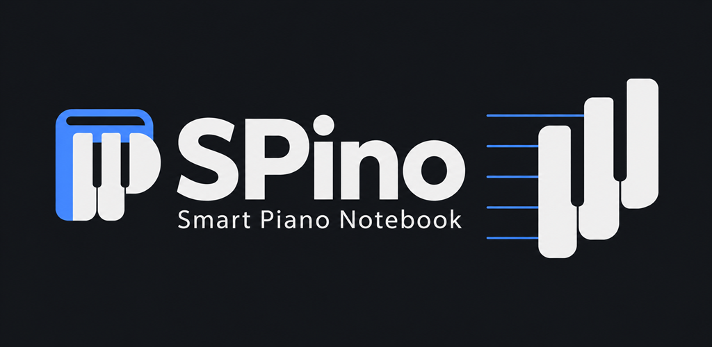

# SPino brand assets

Full name: **SPino: Smart Piano Notebook**. Short name: **SPino** (capital S and P). Use the full name for the store title, document title and formal references; the short name fits launchers and compact headers.



The symbol combines a notebook spine and page with piano-key shapes, suggesting a P. It belongs to the existing dark interface: charcoal `#14161a`, blue `#4f8cff` and ivory `#e8eaed`. Keep it upright, preserve its aspect ratio and leave clear space. At small sizes, use the symbol alone; the product name stays as accessible live text in the app.

## Files

| File | Purpose |
|---|---|
| `spino-symbol-master.png` | Selected generated symbol with alpha; preserve as the source artwork |
| `spino-symbol-512.png` | Transparent symbol for documents and dark layouts |
| `spino-icon-1024.png` | Large square icon with an opaque charcoal background |
| `play-store-icon-512.png` | Google Play icon: 512 × 512, 32-bit PNG, square edges |
| `spino-feature-master.png` | Generated wide composition with the wordmark and expansion |
| `play-store-feature-1024x500.png` | Google Play feature graphic: 1024 × 500, 24-bit RGB PNG, no alpha |
| `PROMPTS.md` | Exact prompts and generation provenance |

The web header and favicons are exported to `public/brand/`. Android density-specific resources are exported under `android/app/src/main/res/mipmap-*/spino_*.png` and `drawable-*/spino_mark.png`. Adaptive foregrounds use a 108 dp canvas with the artwork contained within 56 dp; Android 13+ also receives a monochrome alpha layer. Android supplies the adaptive mask. Legacy round icons are exported separately. Launch screens use the same artwork and charcoal background.

## Re-export

On Windows, from the repository root:

```powershell
.\scripts\export-brand-assets.ps1
```

The script uses System.Drawing for deterministic sizing, padding and format conversion. It does not generate or redesign the artwork. Keep both master files with the repository; no image-generation service is called by the app or the build. No runtime infrastructure is required for these assets. To revise the design, create a new source with the built-in image tool and review it before replacing the selected master. See [the prompt record](PROMPTS.md).

## Store usage

The full name is 27 characters, within Google's current 30-character app-name limit. The icon and feature exports follow the [Google Play preview-asset requirements](https://support.google.com/googleplay/android-developer/answer/9866151?hl=en-GB); Android layers follow the [adaptive-icon guidance](https://developer.android.com/develop/ui/compose/system/icon_design_adaptive). See [the store listing setup guide](https://support.google.com/googleplay/android-developer/answer/9859152) for title and description fields. Requirements were checked on 2026-09-30.

These are prepared graphic assets, not a published store listing. Real phone/tablet screenshots, listing text and production signing are maintained separately. No registration symbols or store badges are included in the logo.
